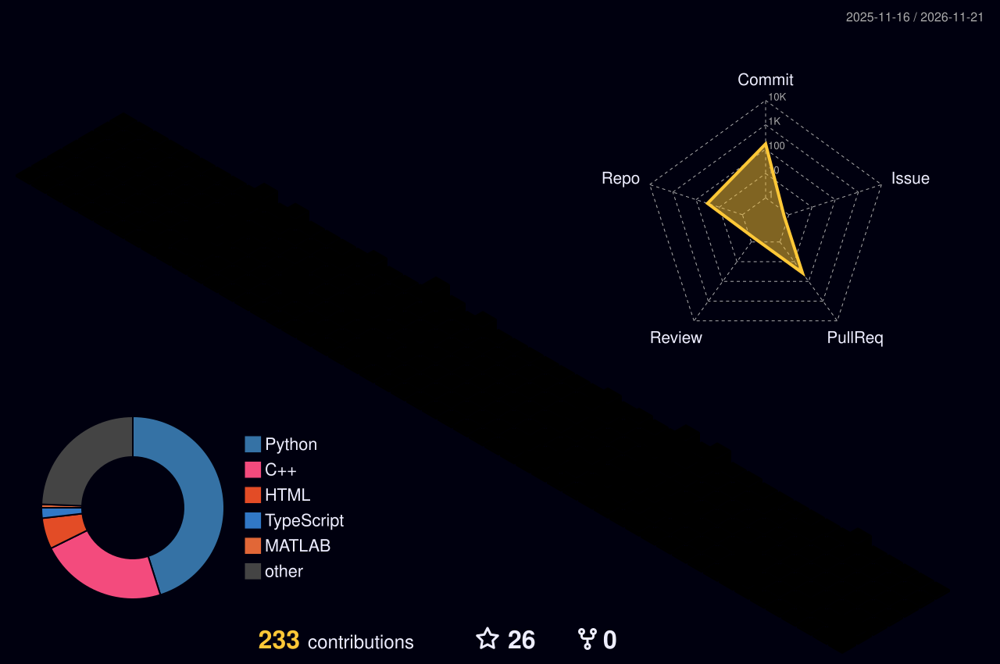

  

 

### About

I'm **Sanchali Torpe**, a B.Tech Computer Engineering student at **Sanjivani College of Engineering**. I build practical **AI/ML** applications in Python, from local RAG systems to LLM evaluation tooling, and I believe in discipline, consistency and shipping real work.

### Featured Projects

<table>
<tr>
<td width="50%" align="center" valign="top">

 <code>FastAPI</code> · <code>RAG</code> · <code>ChromaDB</code> · <code>Ollama</code>
</td>
<td width="50%" align="center" valign="top">

 <code>LLM Evaluation</code> · <code>Bias</code> · <code>Hallucination</code>
</td>
</tr>
<tr>
<td width="50%" align="center" valign="top">

 <code>FastAPI</code> · <code>SQLite</code> · <code>Ollama</code>
</td>
<td width="50%" align="center" valign="top">

 <code>FastAPI</code> · <code>Docker</code> · <code>RL Environment</code>
</td>
</tr>
<tr>
<td colspan="2" align="center" valign="top">

 <code>Python</code> · <code>NLP</code> · <code>Machine Learning</code>
</td>
</tr>
</table>

### Skills

#### Hands-on

<table>
<tr>
<td width="20%" valign="top"><b>Languages</b></td>
<td>

</td>
</tr>
<tr>
<td valign="top"><b>Data &amp; ML</b></td>
<td>

</td>
</tr>
<tr>
<td valign="top"><b>Generative AI</b></td>
<td>

</td>
</tr>
<tr>
<td valign="top"><b>Backend &amp; Tools</b></td>
<td>

</td>
</tr>
</table>

#### Currently Learning

### Open Source & Achievements

<table>
<tr>
<td width="50%" valign="top">

**GSSoC 2026**
 Global Rank **#242** · B Tier *(latest leaderboard I saw)*
 GSSoC Champion badge · First merged PR
 Open Source and AI Agents tracks

</td>
<td width="50%" valign="top">

**Smartly × GSSoC · AI Agents Track**
 🏆 Global Rank **#3** · City Rank **#1** · Top 50
 Trusted Corrector · Localization Specialist · Regional Expert

</td>
</tr>
</table>

### Problem Solving

### GitHub Activity

### Let's Connect

Open to collaborating on **AI/ML, Generative AI, Python and open-source** projects.

  

<i>Strong foundations. Consistent effort. Real projects.</i>

